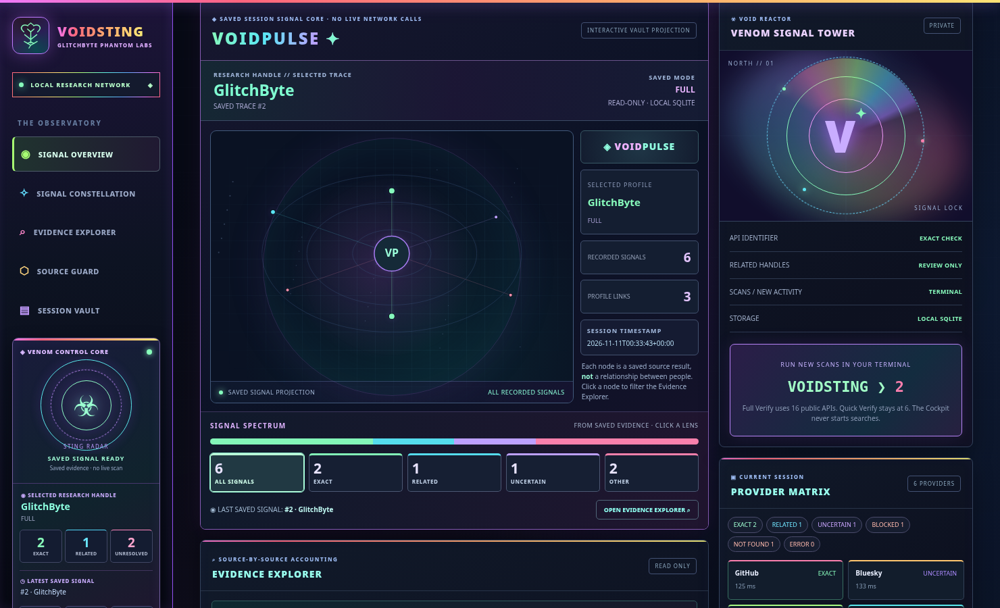

<p align="center"></p>


# ☣ VOIDSTING // VOIDPULSE COCKPIT

**Public profile signals · Clear evidence · Local research vault**  
**GlitchByte Phantom Labs · Linux / Python 3 · Rainbow terminal + VOIDPULSE**

VOIDSTING is independent public-username research software. It is a separate sister to [BLACKSWARM](https://github.com/Hellfire13666/BLACKSWARM-SKULL-SWARM). Both have local visual Cockpits, but **they do not share a database, installation, or backend**.

## Run locally

```bash
bash RUN-VOIDSTING.sh --color always
```

Command `[1] QUICK VERIFY` checks 6 public APIs; `[2] FULL VERIFY` checks 20 public API endpoints; `[3] PUBLIC DIRECTORY + WIDE` checks 20 APIs, 4 public directories, and, **if explicitly installed**, up to 120 additional public-site definitions. `[10] OPTIONAL COCKPIT` prints a local URL but **never automatically opens the browser**.

To enable the optional wide sweep inside this package folder only:

```bash
bash SETUP-WIDE-SEARCH.sh
bash RUN-VOIDSTING.sh --color always
```

This separate virtual environment installs third-party **Maigret 0.6.6**, licensed MIT: <https://github.com/soxoj/maigret>. Maigret isn't bundled in this source release. It may encounter rate limits, inaccessible sites and false positives. Wide results are *review-needed candidates*, not confirmation of a person's account ownership.

## The local Cockpit



The **VOIDPULSE** Cockpit shows saved public username evidence, sessions, status labels, and a constellation of findings. Its data remains local and private. The website hosted through GitHub Pages is a **static showcase only**. It cannot run username searches.

**[Explore the static VOIDSTING home](docs/index.html)** (available after GitHub Pages setup; GitHub's file preview may not load styles).

## Results are not identities

- `EXACT`: API returns a matching handle. Not proof that two accounts are owned by one person.
- `RELATED`: a directory result or wide-site candidate requiring independent review.
- `NOT_FOUND`: absence indicated on that specific endpoint only.
- `UNCERTAIN` / `BLOCKED` / `ERROR`: unresolved, access-restricted or failed requests.

One handle is checked at a time. No credential capture, private-profile access, account-linking conclusions, or automatic browser activity.

## Safety and data protection

All saved sessions go to a **local SQLite vault**, never the public Pages site. Do not commit `.wide-venv`, `~/.local/share/voidsting/`, exported evidence, or private configuration. The `.gitignore` excludes common local research and credential formats. Manually review all files before first publication.

## Project guide

The commands above cover quick scans, full verification, the optional 120-site sweep, and the locally hosted VOIDPULSE Cockpit. The [GlitchByte home page](docs/index.html) showcases the interface; source code, automated tests, and setup scripts remain in this repository.

Review public-profile candidates individually. A username match is not evidence that accounts share an owner, and inaccessible sites are not proof of absence.

© GlitchByte Phantom Labs. No new software license is granted merely by publishing these files. Any reuse or licensing decision belongs to the repository owner.